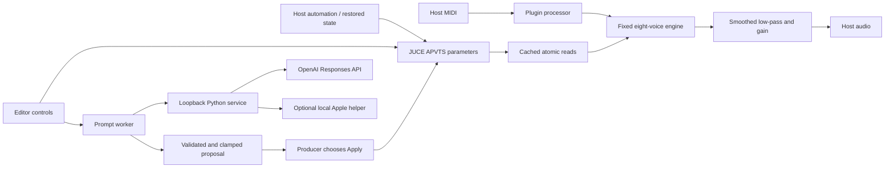

# Architecture and ownership

## Audio thread

`processBlock` clears the existing output buffer, loads eight cached lock-free float atomics into a plain settings snapshot, updates prepared DSP, dispatches existing MIDI bytes at sample offsets, and renders fixed voices and a shared filter. MIDI bytes are inspected directly to avoid allocating JUCE SysEx messages. The callback does not access APVTS trees, strings, editor state, worker mutexes, Python, HTTP, models, or disk.

Voice storage is `std::array<SynthVoice, 8>`. Oscillator/envelope state belongs to each voice; filter and smoothing state belong to the engine. Prepare allocates the JUCE filter's storage and initializes sample-rate-dependent objects before playback. A compile-time assertion requires lock-free float atomics. Float rendering is supported; double precision is not advertised.

Saw and pulse discontinuities use PolyBLEP correction; triangle uses up to 16 odd harmonics below Nyquist. Gain reserves polyphonic/filter headroom. Filter cutoff, resonance, and output gain ramp over 20 ms; waveform and envelope parameter snapshots update per block. A shared post-mix filter is the smallest architecture needed for this milestone; a separate filter per voice is not required for the present behavior.

## Message thread and host state callbacks

The editor owns native JUCE parameter controls, prompt input, proposal display, and an optional prompt worker. It snapshots parameter atomics before submitting a request. A 10 Hz UI timer retrieves worker results; all proposal sanitization and parameter host gestures occur here. The audio thread never takes the worker mutex.

Proposal validation rejects unknown IDs, booleans, strings, empty objects, and nonfinite values. Finite values are clamped to native ranges and choices are snapped. All fields are validated before applying the first field. Multi-parameter host updates remain sequential independent JUCE parameters, rather than an atomic preset transaction.

APVTS state copy/replace and XML serialization belong to host state callbacks outside the render function. Version/type/required IDs/native values are checked before replacing state. UI configuration and credentials are separate from persistent DSP parameters.

## Worker and external service

The editor's worker performs request serialization and HTTP to `127.0.0.1:8765/propose`. Its mutex protects only request/result strings and the cancellable stream pointer. Closing the editor signals exit, cancels an active stream, and joins the worker on the message thread. The processor/audio thread does not own this worker.

The external Python process validates the complete snapshot and sends an OpenAI Responses request with structured output. The API key is read from its environment. It bounds input/output size and timeouts, rejects malformed/incomplete output and duplicate IDs, and clamps legitimate parameter proposals. No API key, network request, inference, or Python code runs in the plugin callback. The optional Swift helper runs Apple's available on-device model in a separate process.

AI failure falls back to a deterministic local rule proposal, clearly labeled as such. A fallback is never treated as a passing live AI test. Human review remains necessary for semantic mistakes, stale snapshots, and musical quality.

## AI formulation and evaluation boundary

Input: producer text plus current native synth parameters. Output: a sparse map of parameter IDs to absolute values. Baseline: deterministic keyword mapping (cutoff multiplier for darker/warmer/brighter; decay/release multipliers for shorter). There is no training dataset, supervised loss, or custom trained model in this milestone. Native structured generation constrains shape, and two independent validators constrain values.

Evaluate validity, direction of requested changes, preservation of unrelated parameters, measured request latency, and listening preference against the baseline. The smoke test establishes integration and simple semantic behavior, not superiority to rules or perceptual quality. Provider latency is outside the real-time deadline. No unmeasured performance or preference claims should be made.
